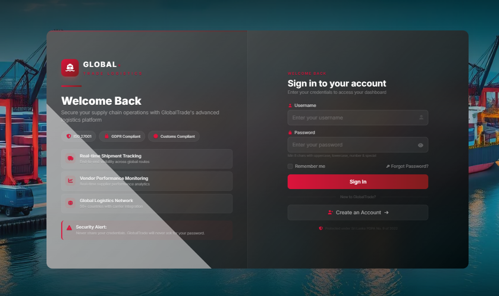
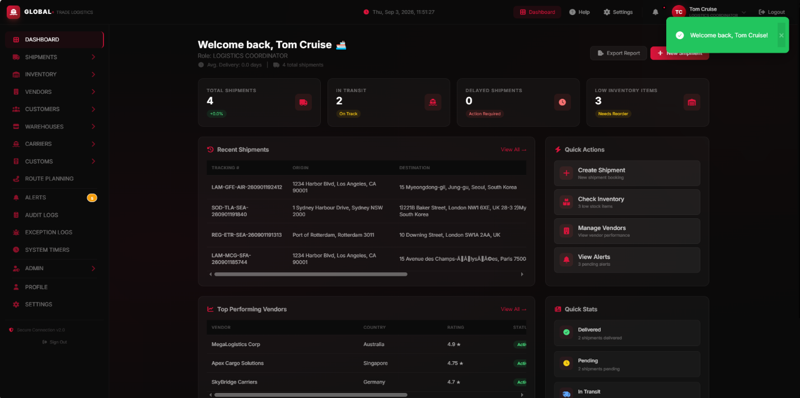
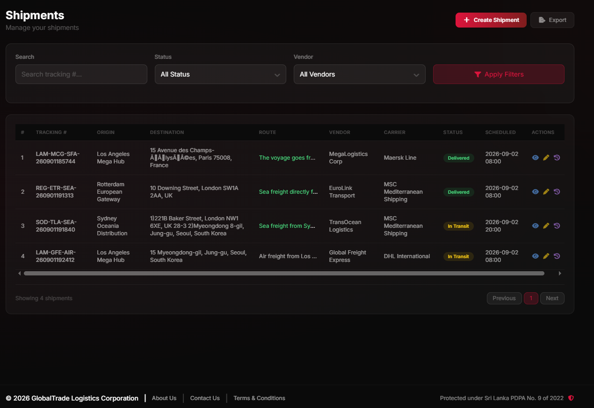
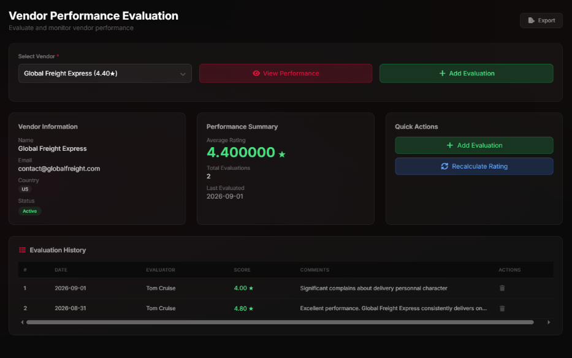
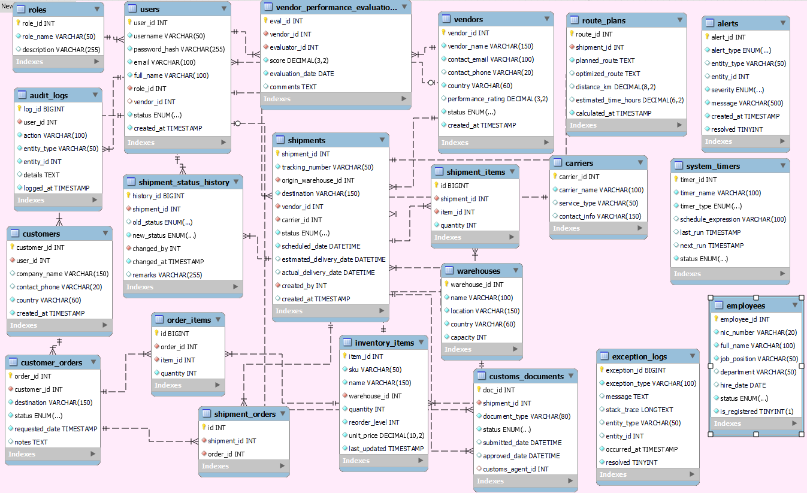

<h1 align="center">🌐 GlobalTrade - Supply Chain Management</h1>

  
  
  
  
  
  

  <strong>GlobalTrade</strong> is an enterprise-grade Jakarta EE web application for comprehensive logistics and supply-chain management. It features role-based dashboards, EJB-driven business logic, and complex relational data mapping.

---

## 📖 Overview

**GlobalTrade** is a robust, request-driven web application designed to coordinate complex supply-chain operations. It manages customers, vendors, carriers, warehouses, inventory, orders, shipments, and customs operations.

The system provides strictly separated, role-based workflows tailored for Logistics Coordinators, Customs Agents, Warehouse Managers, Vendor Representatives, and Customers, ensuring data integrity, security, and operational transparency.

## ✨ Key Features

- **🔐 Security & Auth:** Form-based authentication, role-based authorization, and admin approval workflows.
- **📦 Order & Shipment Management:** Customer order processing, shipment tracking, assignment, and status history.
- **🏢 Vendor & Carrier Hub:** Vendor performance evaluations, carrier management, and route planning.
- **🛂 Customs Operations:** Dedicated customs-document submission and review workflows.
- **📊 Dashboards & Monitoring:** Role-specific dashboards, automated alerts, and scheduled supply-chain monitoring.
- **📝 System Logging:** Advanced audit trails, exception logging, performance tracking, and system-timer records.

## 🛠️ Technology Stack

| Category | Technologies |
| :--- | :--- |
| **Backend** | Java 17, Jakarta EE 10, EJB 4.0, Hibernate ORM 6.5, JPA 3.1, CDI |
| **Frontend** | JSP, HTML, CSS, JS, Tailwind CSS 3.4, DaisyUI, Node.js |
| **Database** | MySQL (Connector/J 9.3.0) |
| **Testing** | JUnit 5.10, Mockito 5.11, Arquillian 1.8, GlassFish Arquillian 2.2 |
| **Server** | GlassFish Application Server |
| **Build** | Maven |

## 📸 System Showcase

| Secure Login | Role-Based Dashboard |
| :---: | :---: |
|  |  |

| Shipment Management | Vendor Performance Tracking |
| :---: | :---: |
|  |  |

## 🗄️ Database Schema

The system utilizes a highly relational MySQL schema managed by Hibernate/JPA. Key entity relationships include:

- **Users & Roles:** `users`, `roles`, `employees`, `customers`
- **Supply Chain Core:** `shipments`, `shipment_items`, `shipment_status_history`, `route_plans`, `carriers`
- **Inventory & Warehousing:** `warehouses`, `inventory_items`
- **Orders:** `customer_orders`, `order_items`, `shipment_orders`
- **Vendor Management:** `vendors`, `vendor_performance_evaluations`
- **Customs:** `customs_documents`
- **System Monitoring:** `audit_logs`, `exception_logs`, `alerts`, `system_timers`

**Entity-Relationship Diagram:**

  

## 🏗️ System Architecture

The application follows a traditional, robust **Enterprise Server-Side Architecture**:

1. **Client Layer:** UI rendered via JSP/JSTL templates, styled with Tailwind CSS and DaisyUI.
2. **Controller Layer (Jakarta Servlets):** Handles HTTP form requests via `@WebServlet` endpoints and routes them.
3. **Business Logic Layer (EJB & CDI):** Requests are delegated through local CDI/EJB service interfaces to stateless session beans.
4. **Data Access Layer (JPA/Hibernate):** DAOs manage transaction boundaries and object-relational mapping using JTA transactions.
5. **Database Layer:** Relational MySQL database interacting via the `jdbc/SupplyChainDB` datasource.

## 🚀 Future Enhancements

- [ ] Migrate to a RESTful API architecture (JAX-RS) to decouple the frontend and backend.
- [ ] Implement WebSockets for real-time shipment tracking updates.
- [ ] Integrate third-party shipping APIs (e.g., FedEx, DHL) for live tracking.
- [ ] Add a dedicated mobile app for warehouse scanning.

## 👨‍💻 Author

**Himansu Nethsara Ranasinghe**
- 🎓 BSc (Hons) Software Engineering Undergraduate (JIAT / BCU)
- 🔗 [LinkedIn](https://www.linkedin.com/in/himansu-nethsara/)
- 🐙 [GitHub](https://github.com/HimansuNethsara)